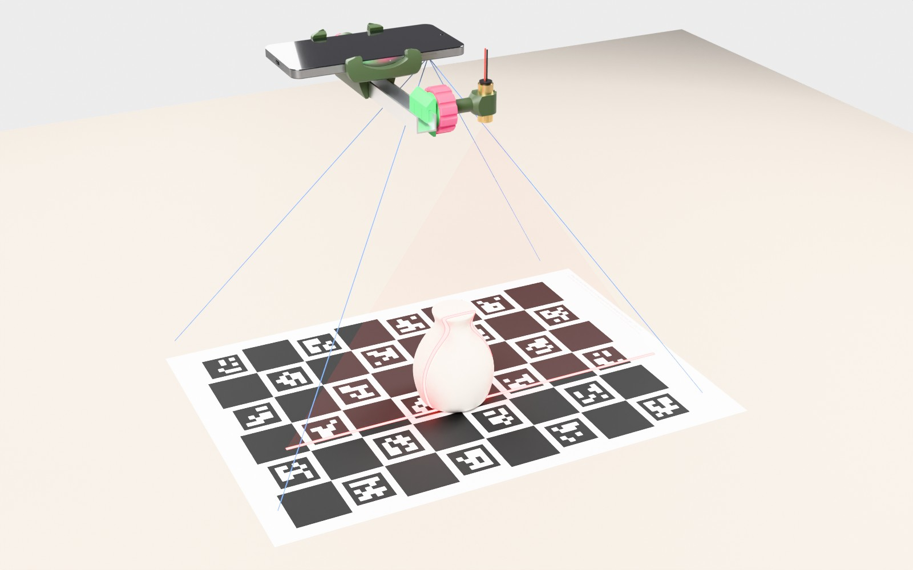
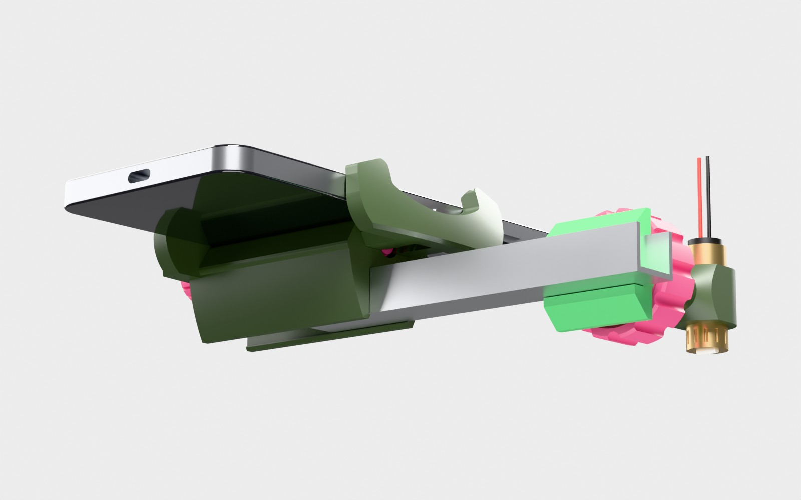
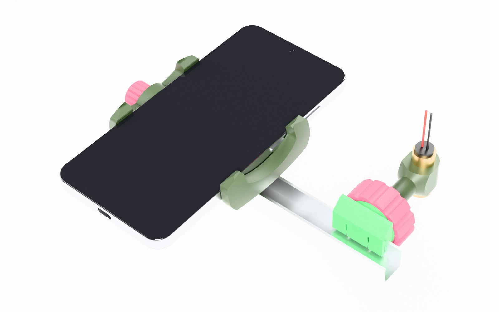
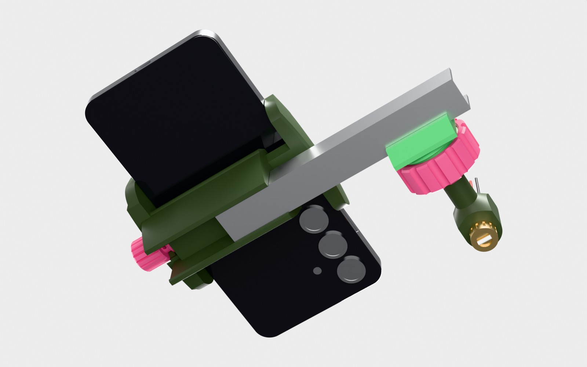
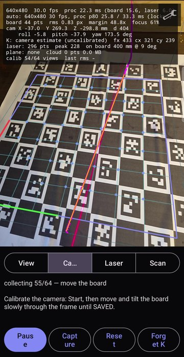
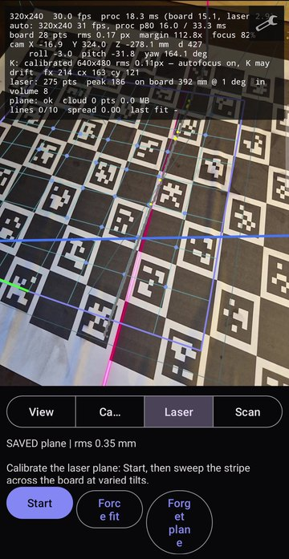
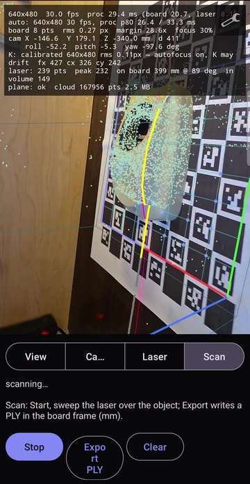
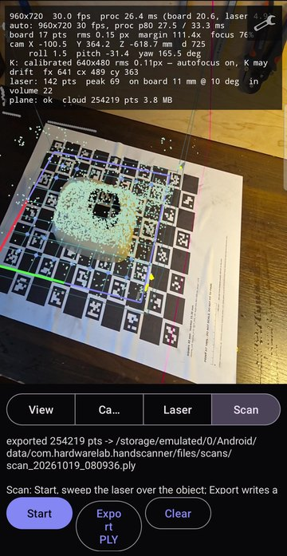
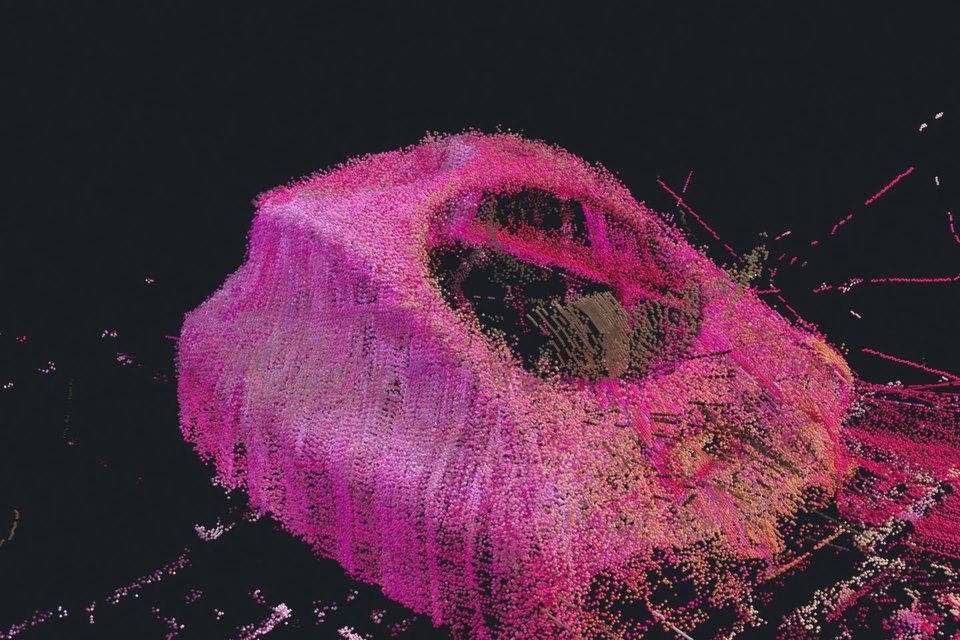

# Easy Scanner v0.2

A hand-held laser line scanner built around an Android phone: the phone's
camera, a cheap line laser clamped next to it, and a printed ChArUco board as
the world anchor. The phone finds its own pose from the board, triangulates
the laser stripe against a calibrated laser plane and accumulates a coloured
point cloud in millimetres — all on the device, in real time. It can also take
posed full-resolution photos alongside the scan, so the photogrammetry
pipeline of [Orbiter](https://github.com/RawMechatronicsOrg/Orbiter) turns a
session into a textured mesh.

This is **not a finished product**. It's a kit of working pieces — an Android
app and printable parts — so other people can build something similar without
re-deriving everything from scratch. Adapt it to whatever phone, laser and
profile you have on the shelf.

**Status**: the app scans on a real phone — camera calibration, laser-plane
calibration and a hand-held scan exported as PLY ([first scan](#first-scan-on-a-real-phone)).
On the emulator the engine's end-to-end tests put the camera within
0.07–1.3 mm at ~500 mm and the laser plane within 0.005°; the accuracy of
real scans has not been measured yet. v0.2 adds a ready
[APK](https://github.com/RawMechatronicsOrg/EasyScanner/releases), the
[assembly](cad/assembly/README.md) (STEP, FreeCAD, glTF), the flange clip for
the laser mount, printable [ChArUco boards](#charuco-boards) from A4 to A0
with their generator, and Z-up PLY exports shared straight from the phone.

## Required setup



The laser must project a **line**, not a dot: a line laser module (a rod or
Powell lens in front of the diode) fans the beam into a flat sheet of light.
Where the sheet meets the object it draws a stripe; the camera sees the stripe
and the board at once, so every stripe pixel becomes a 3D point in the board's
frame. Keep the board in view while you sweep the line over the object.

| Side | From above | From below |
|---|---|---|
|  |  |  |

The phone sits in the clamp with its cameras facing down; the clamp snaps
onto an aluminium U profile, and the ball-head mount at the profile's end
holds the laser. The assembly as 3D files: [`cad/assembly`](cad/assembly/README.md).

What you need:

- An Android phone, Android 10 (API 29) or newer, arm64.
- A line laser module, Ø12 mm body (red or green).
- A 16 × 13 × 1.5 mm aluminium U profile, about 120 mm — the scanner's frame.
- An M5 × 25 socket head cap screw and an M5 tap (for the ball).
- The printed parts from [`cad/`](cad/README.md) (PLA is fine).
- A ChArUco board printed flat on a stiff sheet — see [ChArUco boards](#charuco-boards).

## Quick start

1. **Print the parts**: `cad/export/` (ball-head laser mount: the snap-on
   block `ball_mount_clip.stl` or the flange clip `ball_mount_flange_clip.stl`)
   and `cad/phone-clamp/export/` (phone clamp). Print orientations and
   settings are in [cad/README.md](cad/README.md).
2. **Assemble**: clamp the phone and the laser mount onto the profile, put
   the laser into the ring, tilt the ball so the stripe crosses the camera's
   view, tighten the nut.
3. **Install the app**: download `easyscanner-<version>.apk` from
   [Releases](https://github.com/RawMechatronicsOrg/EasyScanner/releases) and
   open it on the phone (allow installing from this source), or
   `adb install easyscanner-<version>.apk`. To build it yourself
   ([android/README.md](android/README.md) → Toolchain):
   ```powershell
   cd android
   .\gradlew assembleDebug
   adb install app\build\outputs\apk\debug\app-debug.apk
   ```
4. **Print a board**, then follow the app's steps — each one says what to do
   and moves on by itself when it is done; a finished step can be tapped to
   do it again:
   1. **Board**: pick the board you printed (its numbers are on the sheet)
      and point the phone at it; Board OK once the grid lies on the print.
   2. **Focus**: hold the phone at the scanning distance and lock the focus
      where autofocus settled (a calibration holds only at its focus).
   3. **Camera**: Start, then move the phone slowly around the board at
      varied tilts until it says SAVED.
   4. **Laser plane**: Start, then sweep the stripe across the empty board at
      varied tilts. A plane fitted with an earlier camera calibration is
      refused, so a re-calibrated camera always gets a fresh plane.
   5. **Scan**: put the object on the board, Start, sweep the laser over it
      and walk around it; photos are taken on the way. Finish copies the
      whole scan to `Download/EasyScanner/<time>/` — `scan.ply` (binary
      PLY, mm, Z up, the object standing over the board), `laser.ply`, the
      photos and `session.json` for `orbiter-recon` — where a computer sees
      it over USB; Share PLY sends the cloud on.

   Nothing is lost on the way: the scan's cloud is written into its session
   on every pause and whenever the app leaves the screen, the session carries
   on after it comes back, and a scan that never reached `Download` (the app
   was killed) is offered for copying on the next start. Settings → Expert
   mode brings back the four tool modes (View, Camera, Laser, Scan).

   The gallery button next to Settings lists the scans on the phone: a tap
   opens the cloud (drag to orbit, pinch to zoom, two fingers to pan, double
   tap to frame it again) and the scan's photos, full screen on a tap.

## First scan on a real phone

2026-10-19, from the phone's screen recording: calibrating the camera (64
views of the board), the laser plane (rms 0.35 mm), scanning a phone
and exporting the cloud — 254 219 points.

| Camera calibration | Laser plane | Scanning | Export |
|---|---|---|---|
|  |  |  |  |



The recording predates the rename, so the screens still say HandScanner and
export in the old board frame.

## ChArUco boards

Ready-made boards in [`charuco/boards`](charuco/boards), vector PDF at true
scale. All use `DICT_5X5_100` (dictionary id 5) and marker ids from 0.

| Paper | Squares (X × Y) | Square | Marker | File |
|---|---|---|---|---|
| A4 | 4 × 6 | 45 mm | 33.3 mm | [charuco_A4_4x6_45mm.pdf](charuco/boards/charuco_A4_4x6_45mm.pdf) |
| A3 | 6 × 8 | 45 mm | 33.3 mm | [charuco_A3_6x8_45mm.pdf](charuco/boards/charuco_A3_6x8_45mm.pdf) |
| A2 | 8 × 10 | 45 mm | 33.3 mm | [charuco_A2_8x10_45mm.pdf](charuco/boards/charuco_A2_8x10_45mm.pdf) |
| A1 | 9 × 13 | 60 mm | 44.4 mm | [charuco_A1_9x13_60mm.pdf](charuco/boards/charuco_A1_9x13_60mm.pdf) |
| A0 | 10 × 14 | 80 mm | 59.2 mm | [charuco_A0_10x14_80mm.pdf](charuco/boards/charuco_A0_10x14_80mm.pdf) |

Pick the smallest board that the object leaves mostly visible; bigger squares
are read from further away. In the app's Settings → ChArUco board enter
Squares X, Squares Y, Square (mm) and Marker (mm) from the table (or from the
line printed on the sheet); the app's default is 8 × 8 of 45 mm.

Printing: print at 100 % ("Actual size"), never "Fit to page", and check the
100 mm scale bar with a ruler — the square size is what makes the scan
metric; if it printed slightly off, enter the measured square and marker sizes. Glue the sheet
flat onto something stiff (foam board, glass); a wavy sheet bends the frame.

Other sizes: [`charuco/make_board.py`](charuco/make_board.py) draws any board.

```powershell
pip install opencv-python numpy reportlab pymupdf
cd charuco
python make_board.py                                        # every preset above into boards/
python make_board.py --paper A3 --squares 7x9 --square 40 -o my_board.pdf
python make_board.py --check                                # rasterise the PDFs and detect every corner
```

`--marker` sets the marker size (default 0.74 of the square), `--dict` the
ArUco dictionary; a board needs at most as many markers as the dictionary has
(half its squares).

## Repository map

```
EasyScanner/
├── README.md        ← you are here
├── LICENSE          ← Apache-2.0 (default for source code)
├── android/         ← the Android app: Kotlin UI + Rust core (OpenCV ChArUco, laser, geometry)
├── cad/             ← printable parts, CadQuery sources + STL
│   ├── LICENSE      ← CERN-OHL-S-2.0 (hardware)
│   ├── assembly/    ← the whole scanner: STEP, FreeCAD, glTF, render script
│   └── phone-clamp/ ← the phone clamp, a remix of a third-party model
│       └── LICENSE  ← CC BY-NC-SA 4.0
├── charuco/         ← ChArUco board generator and ready PDFs (A4–A0)
└── docs/images/     ← renders used in this README
```

## License

| What                                                     | License                                       |
|----------------------------------------------------------|-----------------------------------------------|
| Source code (Android app, Rust core, scripts, configs, `charuco/`) | [Apache-2.0](LICENSE)               |
| Hardware designs in `cad/` (CadQuery models, `export_stl.py`, STL, the assembly) | [CERN-OHL-S-2.0](cad/LICENSE) |
| The phone clamp in `cad/phone-clamp/` and its parts in `cad/assembly/` | [CC BY-NC-SA 4.0](cad/phone-clamp/LICENSE) |
| Renders in `docs/images/` (they show the phone clamp)    | [CC BY-NC-SA 4.0](cad/phone-clamp/LICENSE)    |

The phone clamp is [Tripod Mobile Phone Clamp V2](https://www.printables.com/model/25969-tripod-mobile-phone-clamp-v2)
by Stamos, remixed for the scanner; it keeps its original non-commercial
share-alike licence. Files outside `cad/` are covered by the root `LICENSE`
(Apache-2.0) unless the table says otherwise.
